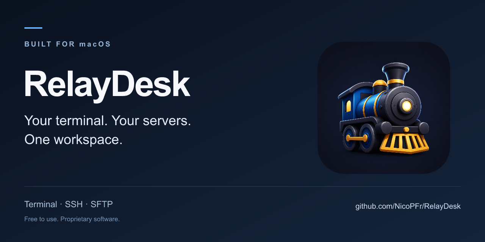
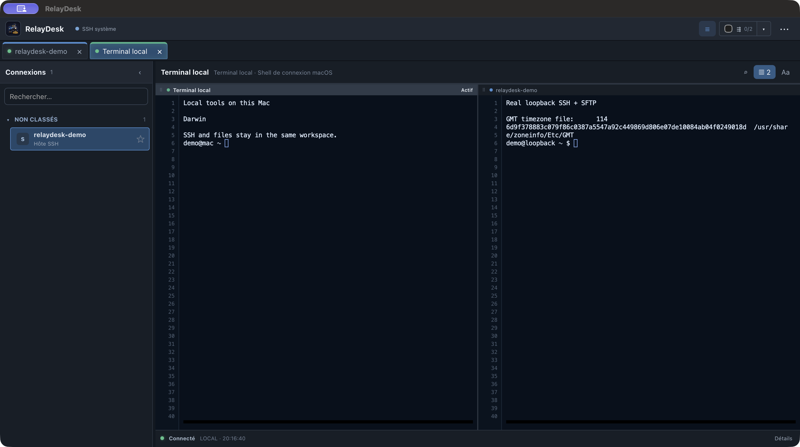
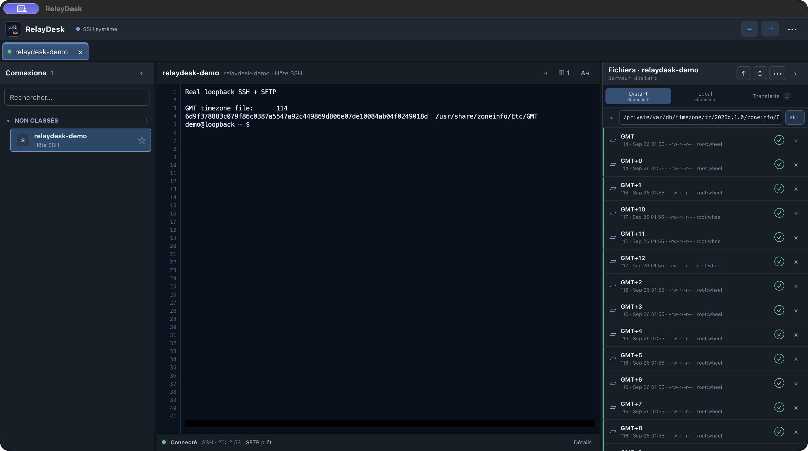

# RelayDesk — SSH workspace for macOS

**SSH terminals, remote files and saved workspaces in one macOS application.**

RelayDesk is for people who work across several hosts and want their terminals,
connections and SFTP files in the same workspace. It uses OpenSSH tools and
your Mac's SSH configuration rather than requiring a RelayDesk cloud account.

**Free to use · Proprietary software · Apple Silicon + Intel**

### [Download RelayDesk for macOS](https://github.com/NicoPFr/RelayDesk/releases/latest/download/RelayDesk.dmg)

**Current public release: 2.11.0** · Universal DMG · Targets macOS 12+

[Installation](docs/installation.md) · [First steps](docs/first-steps.md) ·
[Release notes and checksum](https://github.com/NicoPFr/RelayDesk/releases/tag/v2.11.0)

> The current release is ad-hoc signed, **without Developer ID signing or
> notarization**. macOS or device-management policies may block launch. The
> interface is primarily in French. Read the installation notes before trying it.

  

## Keep the job in one workspace

Captured from the public macOS app using an isolated demonstration profile.
The SSH endpoint is localhost, not a production server.

[45-second presentation](assets/demo/README.md) — native screenshots, French
captions, no audio; not a live screen recording.

### Terminals first

Open a local shell or connect over SSH. Switch between tabs, search output and
use split views to keep related terminals visible. Shared input is optional:
choose its target sessions deliberately before sending a command to several hosts.

### Remote files beside the active session

Browse SFTP directories alongside your SSH terminal. Upload or download with
SFTP/SCP, follow transfers and work with remote files using an external editor.
Check source, destination and replacement prompts before changing files.

The demonstration downloaded a harmless timezone file through the app;
its SHA-256 matched the source. This is a local demonstration, not a benchmark
or a claim of compatibility with every remote server.

### Connections you can find again

Organize hosts in folders, search connections and save named workspaces for the
environments you return to. Use your configured OpenSSH identities and agent;
PKCS#11 is optional for profiles that need it, not required for a local terminal.

See [screenshot provenance and captions](assets/screenshots/README.md).

## Try a small, safe workflow

1. [Install the DMG](docs/installation.md), checking its checksum and macOS security messages.
2. Choose **Ouvrir un terminal local**, or press **⌘T**. Run `pwd` to verify your local shell.
3. Connect to a non-production SSH host you are authorized to use.
4. Open its SFTP pane and work with a harmless sample file. Confirm the destination before transferring it.

The [first-steps guide](docs/first-steps.md) uses the current French interface
labels. You do not need a RelayDesk account for these core workflows. An SSH
server still needs its own access and authentication; a local terminal does not.

## Local-first, not disconnected

Profiles, preferences and workspace state live on your Mac. SSH and transfers
connect to the hosts you choose. Your shell, SSH configuration, links and external
tools can have their own network behavior. History, transcripts and paths can
contain sensitive information; review them before sharing.

[Local data and privacy](docs/privacy.md)

## What to expect today

RelayDesk 2.11.0 provides local terminals, SSH, SFTP/SCP, tabs, split views,
host organization and saved workspaces. The package contains Apple Silicon and
Intel executables; its macOS 12 deployment target is not a claim that every OS
and hardware combination has been tested.

Important limits:

- No Developer ID signature or notarization in the current DMG.
- Primarily French interface and further native workflow qualification needed.
- No configured public in-app update channel: use [GitHub Releases](https://github.com/NicoPFr/RelayDesk/releases).
- Advanced tmux/TUI and hardware PKCS#11 compatibility need further field qualification.

RelayDesk is a focused SSH workspace, not a promise of every WindTerm or
MobaXterm feature. Its macOS app uses Go/Wails, the system WebKit view and
xterm.js; it is not an entirely SwiftUI/AppKit terminal renderer.

## Documentation and feedback

[User documentation](docs/README.md) · [Installation](docs/installation.md) ·
[First steps](docs/first-steps.md) · [Release history](docs/releases.md)

To contribute, report a reproducible issue, suggest a workflow improvement or
help improve the public documentation. Application source code is private;
this repository contains product information and distribution materials.

[Search existing issues](https://github.com/NicoPFr/RelayDesk/issues), then use a
[bug report](https://github.com/NicoPFr/RelayDesk/issues/new?template=bug_report.md),
[installation report](https://github.com/NicoPFr/RelayDesk/issues/new?template=installation_problem.md)
or [feature request](https://github.com/NicoPFr/RelayDesk/issues/new?template=feature_request.md).
English and French are welcome. Include the app version, macOS version and
reproduction steps, but remove credentials, private hosts, paths and operational
output from public issues and attachments.

## License

RelayDesk is **proprietary software, free to use** for personal and professional
purposes under the [RelayDesk license](LICENSE). Public availability on GitHub
does not make its application source open source. Bundled components retain
their own terms: [third-party notices](THIRD_PARTY_NOTICES.txt).
